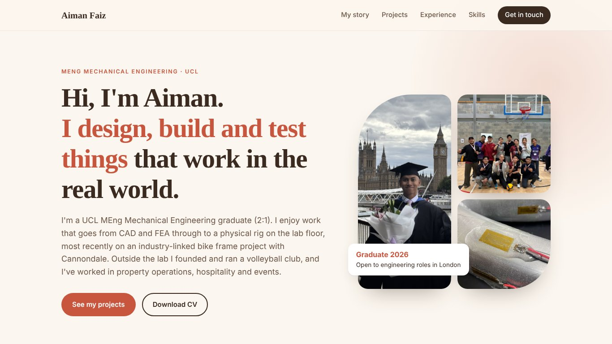

<div align="center">

# Muhamad Aiman Faiz · Mechanical Engineering

**I design, build and test things that work in the real world.**

[](https://muhamadaimanfaiz.github.io/Mechanical-Engineering/)
[](assets/cv/Aiman_Faiz_CV.pdf)
[](https://www.linkedin.com/in/muhamadaimanfaiz)

<a href="https://muhamadaimanfaiz.github.io/Mechanical-Engineering/"></a>

</div>

## About me

UCL MEng Mechanical Engineering graduate (2:1, 2026) and MARA Young Talent Programme scholar. Founder of KUGEM Volleyball Club. I'm looking for graduate mechanical, design or structural engineering roles in London.

## Featured projects

| Project | Context | Highlights |
|---|---|---|
| **High-Performance Bicycle Frame Optimisation** | MEng capstone, with Cannondale | Test rig, 16-channel strain gauge system validated to <1% against theory, Abaqus FEA validation |
| **CNC-Machined Battery Transport Bracket** | Year 2 design project | Generative design, FEA across 3 load cases, Fusion 360 CAM toolpaths |
| **Aircraft Engine Centrifugal Impeller** | Year 2 manufacturing & design | Velocity-triangle blade design, Granta EduPack material selection |

## Skills

`Fusion 360` `SolidWorks` `Abaqus` `ANSYS APDL` `ANSYS Fluent` `Granta EduPack` `Strain gauging` `Arduino DAQ` `MATLAB` `Python` `Excel`

## Other portfolios

- [Data Analyst](https://muhamadaimanfaiz.github.io/Data-Analyst/)
- [Management & Business Operations](https://muhamadaimanfaiz.github.io/Management-Business-Operations/)

## About this site

A hand-built, responsive single-page site (HTML, CSS and vanilla JavaScript, no frameworks), hosted on GitHub Pages.

```
├── index.html      page content
├── style.css       layout, colours and fonts
├── script.js       menu, experience tabs, image gallery and lightbox
└── assets
    ├── img         project and personal photos
    └── cv          CV (PDF)
```

## Contact

📧 [aimannfaizz@gmail.com](mailto:aimannfaizz@gmail.com) · 💼 [linkedin.com/in/muhamadaimanfaiz](https://www.linkedin.com/in/muhamadaimanfaiz) · 📍 London, UK
